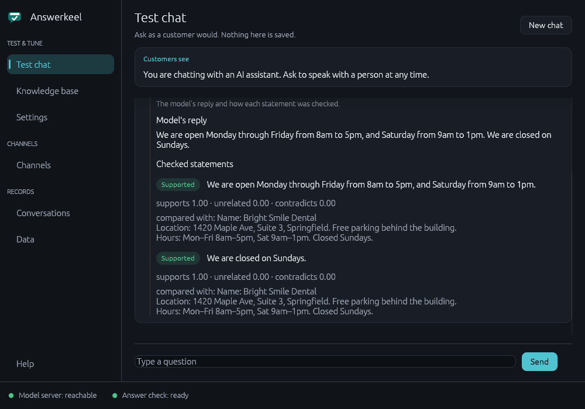
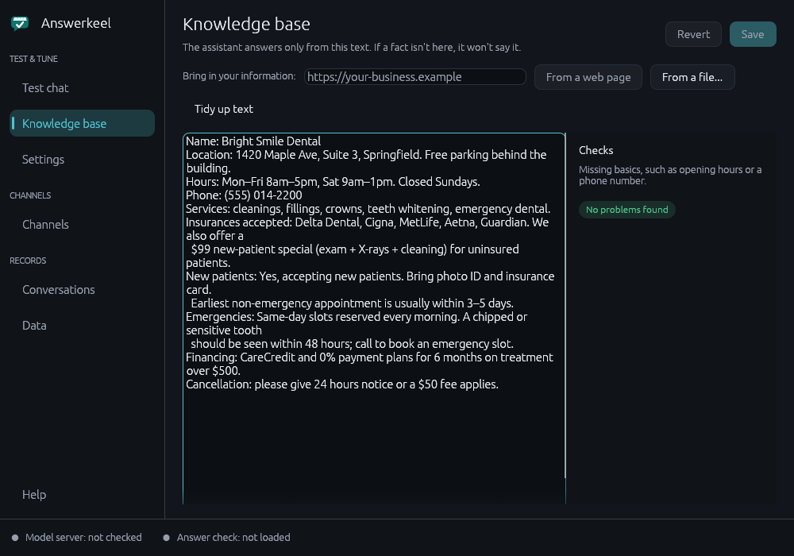
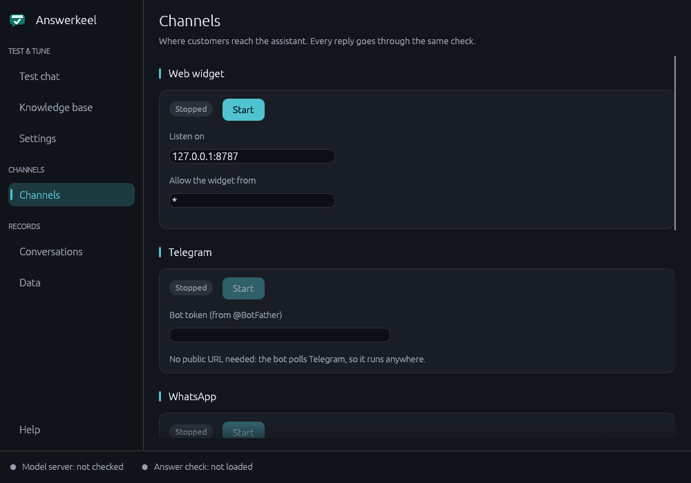

# Answerkeel

A customer-support assistant for small businesses. It answers only from your own
information, and checks every reply before the customer sees it. It runs on your own
computer, so your data stays with you.

Website: https://answerkeel.answerkeel.workers.dev

## Why it's different

Most chatbots guess when they don't know. Answerkeel is built not to.

- It answers only from the text you give it: your hours, prices, policies and so on.
- Every reply is checked against that text. If a statement can't be backed up, the
  customer sees "I can't confirm that, the team will follow up" instead.
- Names, numbers and prices in a reply must appear in your text.
- It runs on your computer. No tracking and no analytics.
- Customers are told they are talking to an AI, and can ask for a person.

## What you can do with it

**Write what the assistant knows.** Paste your information in, or pull it from a web
page or a file. The app points out basics you may have missed, like opening hours or a
phone number.

**Put it where your customers are.** Add a chat box to your website, or connect
Telegram, WhatsApp or email. Start and stop each one from one screen. Email replies are
drafts that a person approves before sending.

**See what it couldn't answer.** The app lists the questions it held back, so you know
what to add next. A trust report shows every reply it blocked and why.

## How well does it work?

In a test on a sample dental practice (22 questions, 3 runs each, one model), 64 of 66
runs were right and no invented fact got through. 2 good answers were blocked by
mistake. That is a small sample. The check makes invented answers less likely. **It does
not promise the assistant will never invent one.** Keep a person in the loop for anything
that matters.

## Not for health data

Don't use Answerkeel to give medical advice or to handle patients' health records.

## Get the app

Answerkeel is not on sale yet. To ask for access or a demo, email
[jamesfrankpacheco@gmail.com](mailto:jamesfrankpacheco@gmail.com?subject=Answerkeel%20access).
The Linux desktop app comes first. A Windows build has not been tested.

---

Copyright (c) 2026 James Pacheco. All rights reserved. This page and its images are for
information only. The Answerkeel software is proprietary and is not published here.
